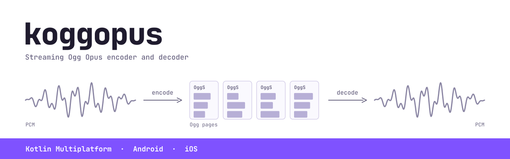

<picture>
  <source media="(prefers-color-scheme: dark)" srcset="docs/header-dark.svg">
  
</picture>

Streaming Ogg Opus for Kotlin Multiplatform, on Android, iOS and the desktop JVM: PCM in,
Ogg pages out;
Ogg bytes in, PCM out.

koggopus is for live audio, such as sending microphone audio over a network connection or
playing a stream as it arrives. It bundles the reference [Xiph](https://xiph.org)
implementations, so the container format (pages, checksums, granule positions, pre-skip,
end trimming) is handled for you.

- **Encoder**: 16-bit PCM, mono or stereo, at any sample rate. Returns whole Ogg pages as
  soon as they are ready, so each result can be sent as one message.
- **Decoder**: accepts the stream in chunks of any size and returns 16-bit PCM at the
  rate and channel count you choose. Handles chained streams and skips corrupt data.

## Installation

In a Kotlin Multiplatform project, add it to the common source set; in an Android-only
project, to the module's dependencies:

```kotlin
kotlin {
    sourceSets {
        commonMain.dependencies {
            implementation("io.github.adrcotfas:koggopus:0.2.0")
        }
    }
}
```

| Platform | Requirements | What is bundled |
|---|---|---|
| Android | API 21 or later | JNI libraries for `arm64-v8a`, `armeabi-v7a`, `x86_64` and `x86`, aligned for 16 KB page sizes, at 0.3 to 0.6 MB per ABI |
| iOS | iOS 14 or later | Static libraries for `iosArm64`, `iosSimulatorArm64` and `iosX64`, linked into your framework |
| Desktop JVM | Java 11 or later; macOS 11 or later (Apple silicon or Intel), or Linux with glibc 2.28 or later (x64 or arm64) | A JNI library per OS and architecture inside the jar, at about 0.5 MB each |

The API is the same everywhere. Nothing else needs installing: the native code is inside
the published artifacts.

On the desktop JVM the library is copied from the jar to a temporary file and loaded from
there. Java 24 and later print a warning when a library loads unless the application runs
with `--enable-native-access=ALL-UNNAMED`. Windows is not supported yet.

## Encoding

```kotlin
val encoder = OggOpusEncoder(
    sampleRate = 16000,
    channels = 1,
    bitrate = 24000,
    application = OpusApplication.VOIP,
    pageDurationMs = 80,
)

send(encoder.headers())            // the two header pages
while (recording) {
    val pcm: ShortArray = readFromMicrophone()
    val pages = encoder.write(pcm) // empty until a page is complete
    if (pages.isNotEmpty()) send(pages)
}
send(encoder.finish())             // remaining audio and the end-of-stream page
encoder.close()
```

`write` also accepts little-endian 16-bit PCM as a `ByteArray`. Input does not have to
arrive in Opus frame sizes; the encoder buffers and reframes it.

`pageDurationMs` sets the trade-off between latency and overhead: each page carries a
header of about 27 bytes plus one byte per packet. At 24 kbit/s, 80 ms pages add roughly
13% overhead and 20 ms pages add roughly 47%.

## Decoding

```kotlin
val decoder = OggOpusDecoder(sampleRate = 24000)

for (chunk in incomingChunks) {              // any size, any alignment
    val pcm: ShortArray = decoder.feed(chunk) // empty until audio is complete
    if (pcm.isNotEmpty()) play(pcm)
}
decoder.close()
```

`decoder.head` and `decoder.tags` expose the stream's headers once they have arrived.

The output layout never changes once it is known. Pass `channels = 1` or `channels = 2`
to choose it; otherwise the first stream decides and `decoder.channels` reports it. A
chained stream with a different channel count is converted, so the audio can go to one
output, such as an `AudioTrack`, throughout. Stereo output is interleaved.

### Decoding a bounded amount at a time

`feed` returns everything a chunk completes, and a few bytes of valid Opus can expand to
a lot of silence: each kilobyte can produce up to about 3 MB of mono or 6 MB of stereo
PCM at 48 kHz. When the stream comes from an untrusted source, or to decode straight
into a playback buffer, queue the input with `push` and collect the audio with `read`,
which never writes more than the buffer you give it:

```kotlin
val buffer = ShortArray(4096)
for (chunk in incomingChunks) {
    decoder.push(chunk)
    while (true) {
        val count = decoder.read(buffer)   // samples written; 0 when more input is needed
        if (count == 0) break
        play(buffer, count)
    }
}
```

A single `feed` that would return more than 2^30 samples throws `OggOpusException` and
discards that audio; `read` has no such limit.

To get the audio as little-endian bytes instead of samples, for a socket or a file, use
`feedBytes` or pass `read` a `ByteArray`.

## Threading and errors

Calls on one encoder or decoder are serialised, so it is safe to `close()` an instance
from another thread, for example to abort a stream. Invalid arguments throw
`IllegalArgumentException`, use after `close()` throws `IllegalStateException`, and
failures in the native layer throw `OggOpusException`.

The decoder stays usable after an `OggOpusException`. A stream it cannot decode, such as
surround, is reported once and skipped; `read` returns the audio ahead of it first and
throws on the following call. Corrupt pages and packets are skipped without an error, and
so is a comment header larger than 16 MB, in which case `decoder.tags` is null.

## Limits

- Mono and stereo only. Surround streams are rejected.
- 16-bit integer PCM only.
- No seeking: the decoder reads a stream front to back.
- No Windows, Kotlin/Native desktop, or web targets yet.

## Building

```sh
git clone --recurse-submodules https://github.com/adrcotfas/koggopus
cd koggopus
./gradlew :koggopus:jvmTest                  # the tests, on the build machine's JVM
./gradlew :koggopus:iosSimulatorArm64Test    # the same tests on the iOS simulator (macOS)
./gradlew :koggopus:connectedAndroidDeviceTest   # and on an Android device or emulator
./gradlew :koggopus:assemble                 # the Android AAR, the jvm jar and, on macOS, the iOS libraries
./gradlew :consumer-check:connectedMinifiedAndroidTest   # the library inside an R8-shrunk app
```

You need the Android SDK with NDK 30.0.16248370, CMake 3.22.1 or later, and a C compiler
for the build machine; for the iOS targets, a Mac with Xcode. The NDK is not downloaded
automatically: install it with `sdkmanager "ndk;30.0.16248370"`. Clone with full
history, as above, because the bundled libraries read their version from their git tags.

The interoperability tests compare against `opusenc`, `opusdec` and `opusinfo` from
[opus-tools](https://opus-codec.org/downloads/) and are skipped when those are not
installed.

The Kotlin code is one public API in `commonMain` over a small binding per platform: JNI
on Android and the desktop JVM (`jniMain`), cinterop on iOS. Gradle runs
`native/CMakeLists.txt` once for each Android ABI, each iOS target, and each desktop
platform the build machine can target: both macOS architectures on a Mac, its own
architecture on Linux.

A local jvm jar holds only those. A published one also needs the Linux libraries, which
`native/build-jvm-linux.sh` builds in Docker on glibc 2.28, one architecture per machine.
Its output directory goes to Gradle as `-Pkoggopus.prebuiltNatives=<dir>`, and the upload
to Maven Central fails unless the jar holds all four libraries.

The native code lives in `native/`: `core/` is plain C over libopusenc, libogg and
libopus, and `jni/` is the thin binding layer Android and the desktop JVM use. `native/test/hostile.c` feeds corrupted
streams to the decoder and is meant to run under AddressSanitizer:

```sh
cmake -S native -B build/sanitize -DKOGG_BUILD_JNI=OFF -DKOGG_BUILD_TESTS=ON \
  -DCMAKE_C_FLAGS="-fsanitize=address,undefined -O1"
cmake --build build/sanitize --target kogg_hostile && build/sanitize/kogg_hostile
```

Every input in that test is decoded three ways (in one piece, in chunks, and through
`push`/`read`) and the results must match. The same harness is a
[libFuzzer](https://llvm.org/docs/LibFuzzer.html) target, which CI runs for a minute on
every push. To run it for longer you need a clang that ships libFuzzer. Apple's does not;
on macOS install Homebrew's `llvm` and use `-DCMAKE_C_COMPILER=$(brew --prefix llvm)/bin/clang`.

```sh
cmake -S native -B build/fuzz -DKOGG_BUILD_JNI=OFF -DKOGG_BUILD_TESTS=ON -DKOGG_BUILD_FUZZER=ON \
  -DCMAKE_C_COMPILER=clang -DCMAKE_C_FLAGS="-fsanitize=fuzzer-no-link,address,undefined -O1"
cmake --build build/fuzz --target kogg_hostile kogg_fuzz
mkdir -p build/fuzz/corpus && build/fuzz/kogg_hostile --seeds build/fuzz/corpus
build/fuzz/kogg_fuzz -dict=native/test/oggopus.dict -max_len=65536 build/fuzz/corpus
```

## Bundled libraries

| Library | Version |
|---|---|
| [libopus](https://github.com/xiph/opus) | 1.6.1 |
| [libogg](https://github.com/xiph/ogg) | 1.3.6 |
| [libopusenc](https://github.com/xiph/libopusenc) | 0.3 |

They are pinned as git submodules under `native/third_party/`. Updating one is a matter
of checking out a newer release tag and running the tests.

## Roadmap

- Watch upstream for fixes: a scheduled job that reports new releases of the three
  bundled libraries.
- Float PCM.
- Loss concealment when packets are missing.

## License

MIT, see [LICENSE](LICENSE). The bundled libraries are BSD-licensed; see
[THIRD_PARTY_NOTICES.md](THIRD_PARTY_NOTICES.md).
